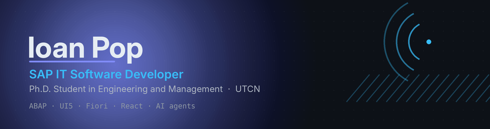
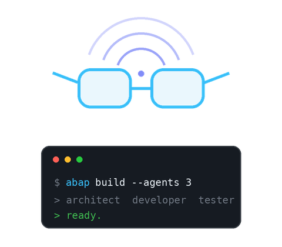
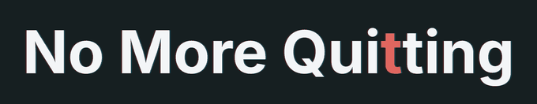

  

### Hi, I'm Ioan Pop 👋

**SAP IT Software Developer @ Siemens Cluj-Napoca**

I build and maintain custom SAP applications — ABAP, Web Dynpro, Fiori and UI5 — and I like automating the parts of the job that don't need a human. Lately that means wiring up multi-agent GitHub Copilot workflows that take a change request from analysis to implementation.

I graduated in **Automation — Systems Engineering** at the *Faculty of Automation and Computer Science*, finished a master's in **Entrepreneurship** at the *Faculty of Industrial Engineering, Robotics and Production Management*, and I'm now a **Ph.D. student in Engineering and Management** — all at the **Technical University of Cluj-Napoca (UTCN)**.

Outside work: chess, basketball and the gym.

 

---

## 🛠 Tech Stack

**SAP**

**Languages**

**Frontend**

**Data & Infrastructure**

**Tools**

**No icon available:** Visual Studio Code · Microsoft Office · UI/UX design · Data Structures & Algorithms · AI agents and prompting

---

## 📌 Projects

### [SynthoVision](https://github.com/ioan-pop-forge/licenta2024ioan) — Bachelor's Thesis
A wearable prototype of glasses for visually impaired people: it captures the surroundings and relays them to the user as interpretable feedback. Covers hardware assembly, software and system integration, with the processing services running on Google cloud infrastructure for non-stop operation. *The public repository holds only part of the code.*

### [CareerSuitUp → HireUp](https://github.com/ioan-pop-forge/hireup) — Recruitment Application
An open-source recruitment platform connecting candidates and job openings. I'm responsible for the application structure, the data model and feature implementation.

### [NoMoreQuiting](https://nomorequiting.com/) — Gym Tracking Application

A live workout-tracking web app with custom workout categories, live session logging and friend leaderboards. I build the React frontend, contribute to the backend and own the UI/UX design.

---

<h2 align="center">🤝 Connect With Me 🤝</h2>

  
  
  
  
  

